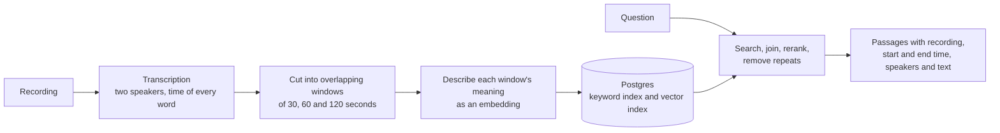
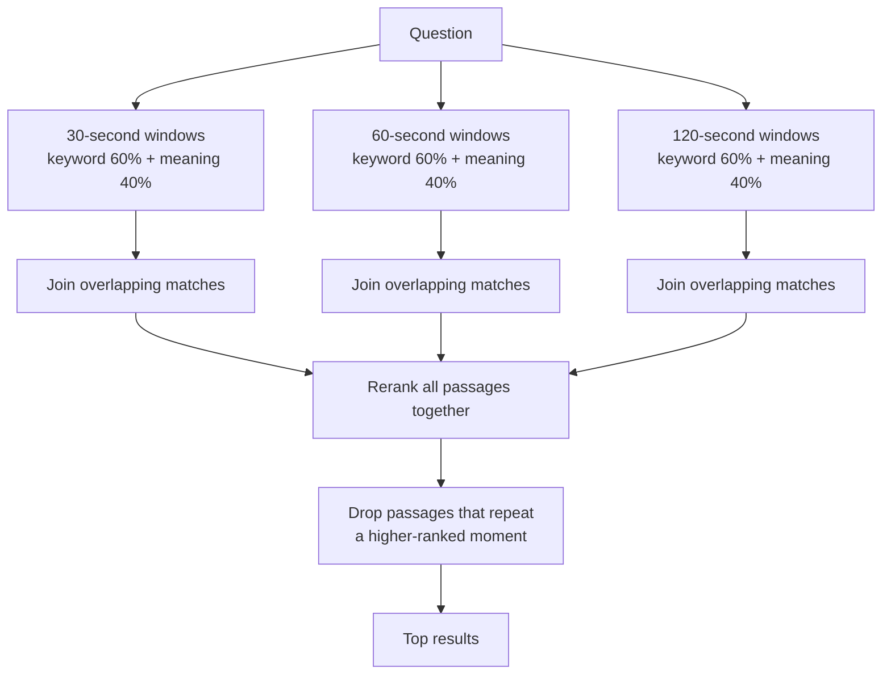
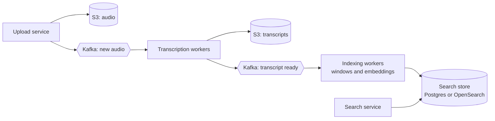

# Searching two-speaker conversations: engineering notes

## What the system does

You give it recordings of conversations between two people, such as interviews, podcasts, calls or meetings, and ask questions in plain language. It returns the passages that answer the question: which recording, where to start and stop listening, who was speaking, and what was said.

1. **Transcribe** each recording, with a speaker label and a timestamp for every word.
2. **Index** the transcript as overlapping slices of time in several lengths, stored in Postgres with a keyword index and a meaning (vector) index.
3. **Search** both indexes, join neighbouring matches into passages, rerank them, and return the best distinct moments.

## Transcription

Any speech-to-text service works. This project uses Google's Gemini transcription model (gemini-3.5-transcribe) with speaker diarization and word timings turned on. The model occasionally invents a stray third speaker; those words are folded back into the two real speakers. The saved transcript is the only thing the rest of the system depends on, so the provider can be swapped freely.

## The retrieval strategy

### Slice by time, not by speaker turns

Conversations vary enormously in shape. An interview can switch speakers every few seconds, while in one of our quantum computing recordings the guest speaks without interruption for over twenty minutes. Splitting by speaker turn fails on both. The monologue becomes one huge chunk that pinpoints nothing, and rapid back-and-forth ("Yeah." "Mm-hm.") becomes fragments that mean nothing on their own.

So transcripts are cut into windows of fixed duration, on word timestamps. Time is the one thing every recording has in common, whatever its format, pace or transcription quality. Each window keeps the speaker labels in its text ("Speaker 1: … Speaker 2: …"), so who said what is preserved. Each window also knows exactly where it starts and ends in the audio.

### Why several window lengths

No single window length is right, because window size is a trade-off:

- **Longer windows carry more semantic noise.** Two minutes of conversation usually covers several points. The window's embedding is a blend of all of them, so the one sentence that answers a question is diluted by everything around it, and the match gets weaker.
- **Shorter windows may not hold a complete idea.** Spoken answers wander, restart and build up slowly. Thirty seconds can cut a thought in half, leaving a question without its answer or an answer without its context.

Indexing every recording at 30, 60 and 120 seconds means every question can find a window that fits it:

- Short windows pinpoint specific facts, names and quotes.
- Mid-length windows hold a complete thought, or a question together with its answer.
- Long windows hold a whole thread of discussion, for broad "why" and "how" questions.

Each window overlaps the next by half its length, so no sentence is lost at a boundary. The system never guesses which length suits a question. It searches all three and lets the reranker decide. The lengths are settings, so a library of short calls or long lectures can use a different mix.

### Hybrid search, weighted towards exact words

Each window length is searched in two ways:

- **Keyword search** uses Postgres full-text search. It reduces words to their root, so "finances" matches "finance". It looks for windows containing *any* of the question's words, so a naturally phrased question still matches on its key terms.
- **Meaning search** compares embeddings of the question and of each window. An embedding is a list of numbers that captures what a piece of text is about, so this search finds paraphrases that share no words with the question.

The two rankings are blended with reciprocal rank fusion. It scores each passage by its position in each list, so the two searches' very different scoring scales never need to be compared. Keyword search gets the larger share of the weight: 60% against 40%.

These weights can be adjusted to prioritize one strategy over another.

### Joining neighbouring matches

Because windows overlap, a relevant stretch of audio usually matches several windows in a row. Within each length, matches that overlap in time are joined into one continuous passage, and its text is rebuilt from the original words so nothing repeats. Two limits keep this in check:

- Longer windows need more overlap before joining: 5, 15 and 30 seconds.
- Each length has a maximum passage length of 90, 180 and 300 seconds, so a run of matches cannot snowball into the whole recording.

### Reranking across lengths, then removing repeats

Passages from different lengths come from separate searches, so their scores are not comparable. The final order is designed to come from a reranker: a model that reads the question together with each passage and scores how well the passage answers it. Because it reads the actual text, it can fairly weigh a tight 30-second answer against a broader two-minute passage. The reranker has its own slot in the pipeline. In this build the slot holds a local ColBERT model, GTE-ModernColBERT-v1. ColBERT describes the question and each passage word by word, and scores a passage by how closely each word of the question matches its best counterpart in the passage. Its underlying model reads long text, so even a five-minute passage is scored on all of its words rather than cut short.

Finally, any passage that overlaps a higher-ranked passage from the same recording by 10 seconds or more is dropped, so the results are distinct moments.

### Why this suits most kinds of audio

- **Podcasts, long answers and lectures.** Long windows capture the whole idea, short windows still pinpoint the key sentence, and nothing depends on speaker changes.
- **Meetings and calls with fast turn-taking.** Time windows gather short turns into meaningful units.
- **Imperfect transcripts.** Keyword and meaning search fail in different ways, so each covers for the other, and neither depends on accurate speaker turns.
- **Any domain, language or transcription provider.** The window lengths, keyword language, search weights and embedding model are all settings. Any provider that returns speakers and word timings works.

## The database design

Everything lives in a single Postgres database, with the pgvector extension for vector search.

### Two tables

**Transcripts**: one row per recording.

| Field | What it holds |
|---|---|
| Audio file | Where the recording is stored. It is unique, so ingesting a recording again replaces it. |
| Transcript file | Where the transcript came from. |
| Words | Every word with its speaker, start and end time, stored once per recording. Used to rebuild clean text for joined passages. |

**Chunks**: one row per window.

| Field | What it holds |
|---|---|
| Transcript | The recording the window belongs to. Deleting a recording deletes its windows. |
| Window length | 30, 60 or 120 seconds. |
| Start and end time | The window's exact position in the audio. |
| Speakers | Who speaks in the window. |
| Text | The window's words, with speaker labels. |
| Keyword form | The text reduced to searchable root words. The database computes it on every write, so it never drifts out of step with the text. |
| Embedding | 768 numbers describing what the text is about. |

### The indexes

- **Keyword index (an inverted index, "GIN" in Postgres).** Like the index at the back of a book: for every root word, it lists the windows that contain it. Searches jump straight to those windows instead of reading every row.
- **Vector index (HNSW).** A layered graph linking each embedding to its nearest neighbours. A search visits only a small fraction of the rows, so search time grows very slowly as the data grows. Every search is limited to one window length, so the index is set to keep searching until it has found enough matches of that length.
- **Window length index and unique audio file.** The first narrows each search to one length. The second guarantees one copy of each recording and makes re-ingestion a clean replacement.

### Why this scales

- **Search work happens inside the database, behind indexes.** Neither search reads the whole table. The web service holds no search state, so more copies of it can run side by side.
- **Keywords and vectors live in one database.** There is nothing to keep in sync. A recording's windows, keyword data and embeddings are written in one transaction, so a recording is never half-indexed.
- **Searches run in parallel.** The six searches behind each question (keyword and meaning, at three lengths) run at the same time over a pool of database connections.
- **Storage stays lean.** Word-level detail is stored once per recording rather than once per window. Embeddings use a reduced size of 768 dimensions, which the model supports natively.
- **Growth is predictable.** Each hour of audio adds about 420 windows, so storage and index size grow in direct proportion to hours of audio.

## At larger scale

This section covers what a large, continuously growing audio library would need. None of it is built yet.

### A complete ingestion pipeline

Today, transcription and indexing start when someone calls the service directly. At scale, recordings and transcripts live in object storage (S3), and Kafka events drive the work:

1. Each upload publishes a "new audio" event.
2. Transcription workers transcribe the audio, store the transcript in S3 and publish a "transcript ready" event.
3. Indexing workers cut the windows, create the embeddings and write them to the search store.

This setup:

- keeps slow, expensive work away from search traffic.
- lets each stage scale by adding workers.
- absorbs bursts of uploads.
- turns rate limits and failures into retries.
- makes it easy to re-index the whole library, for example with a new embedding model, from stored transcripts without transcribing anything again.

### A dedicated search engine

Postgres handles both kinds of search well at moderate scale. For a very large library, a purpose-built search engine such as OpenSearch becomes the better fit. It is designed for exactly this workload and adds features that matter for spoken audio:

- **Dropping filler words** such as "um" and "uh" while indexing, so they do not clutter matches.
- **Fuzzy search**, which tolerates transcription mistakes such as a misheard or misspelled name.
- **Synonyms and phrase matching**, so "GPU" can match "graphics card" and exact quotes can be found.
- **BM25 ranking by default**, which gives rare, distinctive words more weight than Postgres's built-in ranking does.
- **Vector search and hybrid ranking built in**, so keyword and meaning search still live in one system.
- **Horizontal scaling**, by spreading the index across many machines and adding copies to handle search traffic.

### Models

- The local reranker model moved out of the web service onto its own GPU-backed service.
- A local embedding model, removing per-request cost and rate limits or an enterprise paid service.
- Search filters by recording, speaker or date, using details already stored with each window.

## Production metrics and evaluation

### Metrics that matter

**Search quality: is the right moment found?**

- **Recall at k.** How often the passage that answers a question is among the top k results. This is the headline number: if the answer is not retrieved, nothing later can fix it.
- **Position of the first correct result.** Listeners rarely go past the first two or three results, so a correct answer in eighth place is close to a miss.
- **Timestamp precision.** How close the returned start time is to where the answer begins, and how much extra audio comes with it. Recall alone can mislead here. A passage long enough to cover half a recording "contains" almost any answer, but nobody wants to listen to all of it.
- **Unanswerable questions.** How often the system returns confident results for a question the audio does not answer.

**Transcription quality: the foundation everything else stands on**

- **Word error rate**, especially on names and technical terms, since those drive keyword search.
- **Speaker attribution errors.** Wrong labels break questions about who said what.
- **Timestamp accuracy.** A shifted timestamp sends words into the wrong window.

**Speed, cost and reliability**

- **Search time.** Measure both the typical search and the slowest 5%, broken down by stage: understanding the question, the database searches and reranking.
- **Time to searchable.** How long after upload a recording can be found, and how large the processing backlog is.
- **Cost** per hour of audio ingested and per thousand searches, covering transcription, embeddings and reranking.
- **Reliability.** Track error rates, rate-limit rejections from model providers, failed ingestion jobs, and database health.

**User outcomes**

- How often a search leads to someone playing a result, and which position they pick.
- How often people rephrase or give up.
- How long it takes them to find what they wanted.
- Explicit thumbs up or down.

## Alternative ideas not explored (time constraints)

The hackathon's time limit meant these alternative retrieval ideas could not be explored. Each one would slot into the existing pipeline without changing the rest.

### Metadata search

A language model reads every window at indexing time and tags it from a predefined set of metadata, such as the topics discussed, the people, companies and products mentioned, or whether the passage asks or answers a question. At search time, the same model tags the question with the same set.

Matching tags is a simple lookup against a standard database index, with no similarity scoring. That makes it fast and deterministic, and it would become a third search strategy alongside keyword and meaning search. Its matches would join the other candidates, and the reranker would combine them all.

Metadata search is precise on structured facts such as who, which company or which product, however the question is worded. It is also cheap at search time, because the expensive tagging happens once, when a recording is indexed.

### Query expansion

A small, fast language model rewrites the question before meaning search. It adds likely phrasings, synonyms and related terms, or drafts a short example answer.

Spoken conversation is loose and informal, while typed questions are compact. Expanding the question brings it closer to how people actually talk about a topic, so meaning search finds more of the right passages. Because the model is small, it adds little delay.

### Stronger reranking

The reranker slot can hold more capable models:

- **Language-model reranking.** A general language model reads the question and each candidate passage and judges how well the passage answers it. It handles nuance and conversational context well, but costs more and is slower, so it suits a final shortlist.
- **Newer purpose-built models**, such as Jev, recently released by TypeSafe AI. It scores every candidate passage in a single fast call and returns a relevance probability for each. Because the scores are probabilities, weak passages can be dropped outright instead of always returning a fixed number of results.
